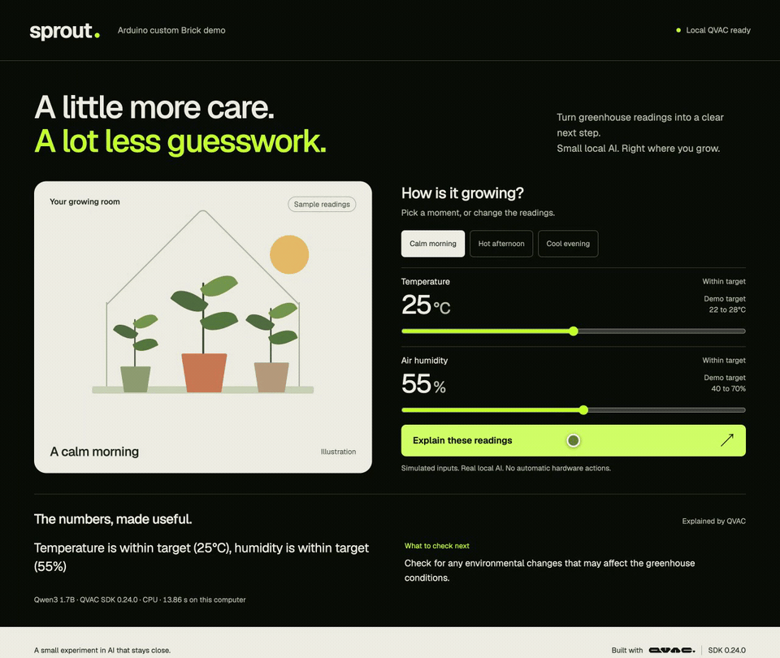

# Sprout

**A small greenhouse helper powered by QVAC, with an Arduino App Lab custom Brick.**

Use live DHT11 readings on an Arduino UNO Q, or choose sample readings in the standalone demo. Sprout explains what they mean and suggests what to check. AI runs locally on the device hosting Sprout, with no API key or cloud AI service.



Real app footage from the Linux ARM App Lab developer runtime. The readings are simulated. [Watch the narrated demo](https://github.com/victorchimakanu/sprout-qvac-arduino/releases/download/v0.1.0/sprout-demo.mp4).

## Live readings on Arduino UNO Q

The UNO Q version now supports a **DHT11** connected to **GND, 3.3V and D2**. Live mode displays measured temperature and humidity, refreshing every few seconds. Click **Explain these readings** for a local QVAC explanation. **Sample data** retains the original simulated scenarios.

The sensor is read on the MCU and passed to Linux using Arduino Bridge. Missing or stale readings display an error; they are never replaced with sample values. Each AI answer identifies the measured snapshot it explains. See [live DHT11 setup](docs/live-dht11.md).

- [Wiring and implementation walkthrough](docs/live-dht11.md)
- [Changes compared with the original project](docs/hardware-changes.md)
- [Optional UNO Q storage setup](deploy/uno-q/README.md)
- [Hardware test results](docs/verification/README.md) and [on-board checks](tools/hardware/README.md)
- [Fork and pull request preparation](docs/contributing-hardware.md)

Use the source from this hardware branch for live DHT11 support. The upstream **v0.1.0** downloads below are the original sample release and do not contain these hardware additions. The tested hardware route used on-board CLI setup and manual MCU upload, as documented in the walkthrough.

## Try it in 3 minutes

You need **Node.js 22 or newer** and Git. No Arduino board is needed for this laptop demo.

The steps take about three minutes. Allow extra time for the first package install and the roughly **1 GB model download**, depending on your connection. Keep internet access on until you see `QVAC ready`.

```sh
git clone https://github.com/victorchimakanu/sprout-qvac-arduino.git
cd sprout-qvac-arduino
npm run setup
npm start
```

Open **[http://127.0.0.1:8765](http://127.0.0.1:8765)** when the terminal says `QVAC ready`.

1. Choose **Hot afternoon**.
2. Click **Explain these readings**.
3. Read the explanation and **What to check next**. Try **Cool evening** too.

After the model downloads, answers run locally. Stop the app with `Ctrl+C`. Next time, just run `npm start`.

## Original sample release in App Lab

A Brick is a reusable part of an App Lab app. This one lets Python ask a local QVAC model for an answer.

1. [Download the App Lab ZIP](https://github.com/victorchimakanu/sprout-qvac-arduino/releases/download/v0.1.0/sprout-app-lab.zip).
2. Import it into App Lab with a supported board connected, then click **Run**.
3. Wait for `Sprout is ready`, then open the web view on port **8765**.

The custom Brick has been verified on a **4 GB Arduino UNO Q with a live DHT11 on D2**. The earlier Linux ARM developer runtime also passed import, build, Python Brick requests and browser tests. See the [App Lab guide and test details](docs/app-lab.md).

## Useful details

- QVAC SDK **0.24.0**, Qwen3 **1.7B Q4**, running on the CPU.
- Live DHT11 readings on UNO Q, plus simulated sample mode. No automatic hardware actions.
- Example targets, not crop-specific growing advice.
- [Troubleshooting and the Python example](docs/app-lab.md#laptop-help).
- Sample code: [MIT license](LICENSE). Fonts and branding: [third-party notices](THIRD_PARTY_NOTICES.md).
