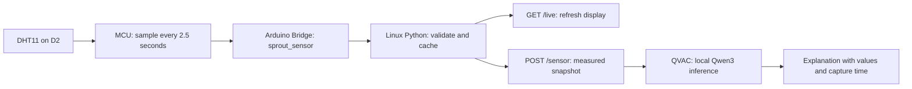

# Live DHT11 readings on Arduino UNO Q

This hardware adaptation connects Sprout's existing QVAC Brick to a real DHT11. The original QVAC SDK, Qwen3 model and example target ranges are retained. The additions cover MCU acquisition, Arduino Bridge transport, validated live data and a live interface alongside sample mode.

Implemented and tested on **22 November 2026**; documentation expanded on **23 November 2026**. Baseline: upstream commit [`506a44d9f22f7e14c52168762b66b5b799bc540a`](https://github.com/victorchimakanu/sprout-qvac-arduino/commit/506a44d9f22f7e14c52168762b66b5b799bc540a).

## Tested environment

| Component | Version/setup |
| --- | --- |
| Board | UNO Q, 4 GB RAM, 32 GB eMMC |
| Sensor | DHT11 module, DATA on D2 |
| Linux | Debian 13, reported version 13.2 |
| Arduino App CLI | 0.13.0 |
| Arduino CLI | 1.5.1 |
| MCU core | `arduino:zephyr` 0.90.0 |
| Bridge | Arduino_RouterBridge 0.4.3 |
| DHT driver | Adafruit DHT sensor library 1.4.6 |
| Unified Sensor | 1.1.15 |
| AI | QVAC SDK 0.24.0, Qwen3 1.7B Q4, CPU |

All MCU dependency versions are pinned in [sketch.yaml](../app/sketch/sketch.yaml). The upstream guide described a newer App CLI; these are the versions actually verified on our board, not a compatibility claim for all releases.

## Wiring

Disconnect board power before changing wiring. Follow the module labels: pin order can differ.

| DHT11 module | UNO Q |
| --- | --- |
| GND / − | GND |
| VCC / + | 3.3V |
| DATA / S | Digital pin 2 (D2) |

This is the three-connection module setup tested here. A bare sensor may need a DATA pull-up; that setup was not tested.

## Data flow



The sensor loop is independent of inference. Measurements continue updating while an answer takes about a minute. Each answer identifies its captured values/time, rather than implying it describes a newer display value.

## Implementation steps we took

### 1. Establish USB access and check the existing software

On the connected computer:

```sh
adb devices -l
adb -s "$UNO_SERIAL" shell 'id; hostname; uname -srm'
```

Use the serial reported by `adb devices -l` for `UNO_SERIAL`. ADB was installed, but the development sandbox initially blocked USB/server access. We ran approved host control commands outside that sandbox. This did not execute Sprout on the computer.

On the Arduino, we checked OS/App CLI versions, failed services, Docker and disk space, then named it:

```sh
arduino-app-cli system set-name sprout-test
systemctl --failed --no-pager
df -h / /home/arduino
```

Wi-Fi was configured through NetworkManager. On another board, connect interactively without saving a password in a script:

```sh
nmcli --ask device wifi connect "YOUR_WIFI_SSID"
ip -4 -brief address show wlan0
```

### 2. Inspect and import the original source on the board

We cloned the original repository into `/home/arduino/projects/sprout-qvac-arduino`. Its HEAD at the time was the baseline linked above. We inspected the README, Python bridge, server, Dockerfile and locked dependencies before installing them.

The initial app was packaged as a source ZIP and imported through the on-board App CLI. This first import was the original Python/custom-Brick app, before our sensor sketch existed.

### 3. Resolve the system-partition storage limit

The first normal container build installed QVAC dependencies under Docker's system-partition storage. Our Linux partition was about 10 GB, while `/home/arduino` was about 18 GB. Free system space fell below 1 GB during installation.

We stopped the build before the partition filled. App CLI's stop command stopped the app but did not cancel the active Docker build, so we also terminated that specific build process. An old process ID from the original session must not be reused for another build.

We switched to a lightweight runtime image and moved large files to:

| User-partition directory | Contents |
| --- | --- |
| `/home/arduino/projects/sprout-runtime` | Runtime source and Node dependencies |
| `/home/arduino/projects/sprout-npm-cache` | npm download cache |
| `/home/arduino/projects/sprout-models` | QVAC model storage |

Installation completed with 227 packages, approximately 2.6 GB of dependencies and 942 MB of npm cache. Linux retained about 3.8 GB free. The model was downloaded afterward on the Arduino.

The adjustment originally existed only in the imported app. It is now recorded as the optional [UNO Q deployment setup](../deploy/uno-q/README.md), while the source's default Dockerfile/Compose layout remains available.

### 4. Verify the sample app on physical hardware

Before connecting a sensor, we tested all three sample scenarios through the Python web view/custom Brick. We also disconnected the board's Wi-Fi, obtained a local explanation through ADB and restored Wi-Fi. This verified offline inference after the model download.

### 5. Implement DHT11 acquisition and the live API

We saved the imported app's source/configuration as `/home/arduino/projects/sprout-before-live-sensor.tar.gz`. This is an app backup, not a complete Linux image or an old MCU firmware dump.

On the Arduino, we installed:

```sh
arduino-cli lib install "DHT sensor library@1.4.6"
```

We added the [MCU sketch](../app/sketch/sketch.ino), pinned profile and [Linux reader](../app/python/live_sensor.py). The standalone profile needed the complete Bridge dependency tree explicitly declared: RouterBridge, RPClite, MsgPack, ArxContainer, ArxTypeTraits and DebugLog, plus the DHT libraries.

The sketch samples every 2.5 seconds and provides JSON through `sprout_sensor`. Linux polls it in a background thread. Invalid readings or readings older than 10 seconds are unavailable; no zeroes or simulated values are substituted.

The first standalone compile installed the platform's ARM compiler and supporting tools on the Arduino. Initial missing-library errors were resolved by declaring the full dependency tree in the profile; subsequent builds reused the installed tools.

The [web view](../app/bricks/qvac/webview.py) adds `GET /live`. For `POST /sensor` with `source: live`, it selects the measured snapshot itself and ignores client-supplied temperature/humidity. QVAC receives the measurement and its provenance.

### 6. Compile and upload the matching MCU firmware

Compilation ran on the Arduino:

```sh
arduino-cli compile \
  --fqbn arduino:zephyr:unoq \
  --build-path /home/arduino/projects/sprout-dht-build \
  /home/arduino/projects/sprout-qvac-arduino/app/sketch
```

The successful build used **81,568 program bytes** and **29,514 dynamic-memory bytes**.

The board's older `arduino-flash` helper used a different sketch address from core 0.90.0. We used the matching core's `flash_sketch.cfg` to verify/upload the Zephyr MCU image and sketch. The upload had this form, on the Arduino:

```sh
CORE_DIR=/path/to/the/arduino_zephyr_0.90.0_core_used_for_this_build
BUILD_DIR=/home/arduino/projects/sprout-dht-build

/opt/openocd/bin/openocd -d2 -s /opt/openocd \
  -f openocd_gpiod.cfg \
  -c "set filename0 $CORE_DIR/firmwares/zephyr-arduino_uno_q_stm32u585xx.elf" \
  -c "set filename1 $BUILD_DIR/sketch.ino.elf-zsk.bin" \
  -f "$CORE_DIR/variants/arduino_uno_q_stm32u585xx/flash_sketch.cfg"
```

`CORE_DIR` must match the successful compile output. Ours was under `/home/arduino/.arduino15/internal/arduino_zephyr_0.90.0_*`. This records the tested upload method; do not substitute a different core/image/address.

Only the STM32 MCU firmware was uploaded. **Debian/Linux was not formatted or reflashed.** A factory image was separately downloaded for possible future recovery, but never flashed and is not required by this project.

### 7. Deploy live mode

We copied the new Python/runtime/UI files into the imported app and mounted `sprout-runtime` directory, retaining its storage adjustments. We restarted the existing containers:

```sh
docker restart sprout-app-lab-qvac_runtime-1
docker restart sprout-app-lab-main-1
```

The cached model was reused. The Python reader and web view started, and the imported app also received the MCU sketch source for reference.

This manual MCU upload plus on-board deployment is the verified route. A fresh full-source import that delegates the added sketch's upload to the desktop App Lab UI has not been independently tested.

### 8. Verify live data and explanations

The first direct Bridge reading was **24.3°C / 71% humidity**. Later samples advanced in sequence and capture time.

In the live test, the client deliberately supplied `99` for both measurements alongside `source: live`. The service ignored those numbers. QVAC explained the actual **24.1°C / 73%** snapshot in **58.65 seconds**. Another measurement arrived during inference.

The [test receipt](verification/live-hardware.json) records the samples, timestamps, sequences and answer. The [verification index](verification/README.md) separates physical hardware tests from controlled error-path tests.

## Using the running app

Open `http://BOARD_IP:8765`, using the address from `ip -4 -brief address show wlan0`. Refresh an already-open interface after deployment.

1. Select **Live DHT11** and check that the readings/update time refresh.
2. Click **Explain these readings**; allow about a minute on this board.
3. Read the captured values/time beside the answer; the live display may have advanced.
4. Select **Sample data** to use the original presets/sliders.

If readings are unavailable, check the sensor model, module pin labels, D2, 3.3V and GND. The app waits for valid data instead of hiding a fault with sample readings.

## Execution boundary and limits

All installation, Docker builds, MCU compilation/upload, Python and inference ran on the Arduino. The connected computer provided ADB control and source review. Opening the interface runs its JavaScript in the browser; sensor acquisition, Python and AI remain on the board.

- Only DHT11 on D2 is verified. Other sensors/pins need separate testing.
- Targets remain the original demo values: 22–28°C and 40–70% humidity.
- Suggestions do not operate fans, pumps or heaters.
- No history database, charts, notifications or automatic continuous inference were added.
- Error/staleness handling used controlled tests; we did not physically unplug the sensor as a fault test.
- We did not run browser automation on the computer or verify a fresh desktop App Lab import/Run flow for the complete hardware app.
